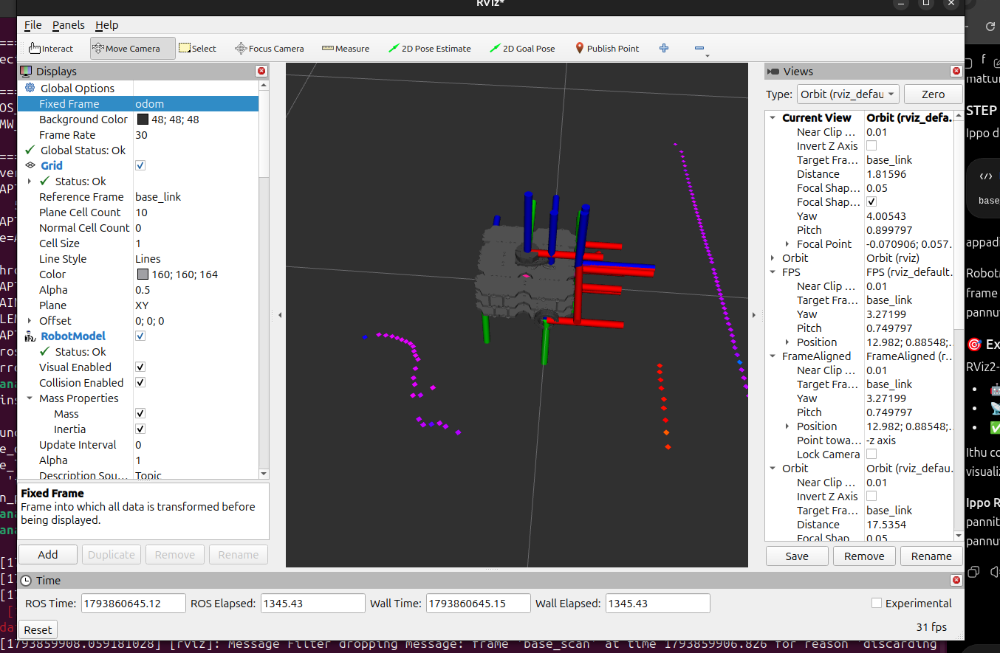
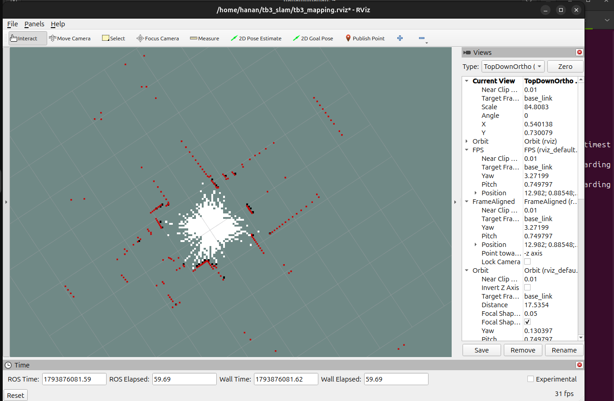
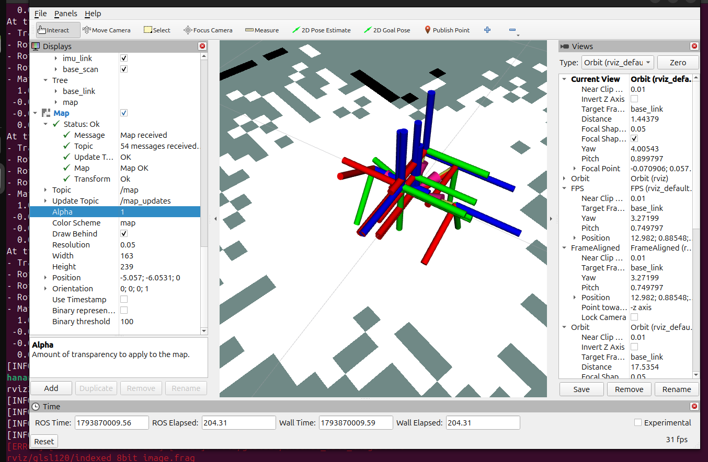

# TurtleBot3 Autonomous Indoor Navigation & Inspection

A real-world autonomous mobile robotics project built using
**ROS 2 Jazzy, TurtleBot3 Waffle Pi, Raspberry Pi 4, OpenCR,
LDS-02 LiDAR, SLAM Toolbox, and RViz2**.

The project focuses on real-time indoor mapping, autonomous
navigation, and future camera-based laboratory inspection.

> **Project Status:** Active Development
> **Current Milestone:** Physical TurtleBot3 Nav2 goal navigation demonstrated (12 November 2026; multiple runs reported)
> **Next Milestone:** Camera livestream and waypoint-based laboratory inspection

## Project Objectives

- Build a ROS 2-based autonomous mobile robot.
- Generate real-time 2D maps of indoor environments.
- Perform autonomous navigation using Nav2.
- Implement obstacle-aware navigation.
- Integrate camera-based remote monitoring.
- Develop autonomous laboratory inspection missions.
- Evaluate robotic communication performance for research.

## Hardware

| Component | Specification |
|---|---|
| Robot | TurtleBot3 Waffle Pi |
| Computer | Raspberry Pi 4 Model B (2GB) |
| Controller | ROBOTIS OpenCR |
| Motors | DYNAMIXEL |
| LiDAR | LDS-02 |
| Camera | Raspberry Pi IMX219 CSI |
| Development Computer | Ubuntu Laptop |

## Software Stack

- Ubuntu 24.04 LTS
- ROS 2 Jazzy
- Fast DDS
- Python
- SLAM Toolbox
- RViz2
- Nav2 (map server, AMCL, planner, MPPI, velocity smoother, collision monitor)
- RTAB-Map (future development)

## System Architecture

```text
              TurtleBot3 Waffle Pi
                       |
                Raspberry Pi 4
                       |
          +------------+------------+
          |                         |
        OpenCR                    LDS-02
          |                         |
    Motors + IMU                  LiDAR
    + Encoders                     |
          |                         |
        /odom                     /scan
          |                         |
          |                 Scan Normalizer
          |                         |
          |                  /scan_normalized
          |                         |
          +------------+------------+
                       |
                   ROS 2 DDS
                       |
                Ubuntu Laptop
                       |
                 SLAM Toolbox
                       |
                  /map + TF
                       |
                     RViz2
```

## Completed Development

The following features have been implemented and tested:

- Raspberry Pi and laptop ROS 2 communication.
- Custom headless robot bringup.
- OpenCR integration.
- ROS-controlled motor movement.
- Motor torque enable/disable.
- Wheel encoder feedback.
- IMU and wheel odometry.
- LDS-02 LiDAR integration.
- Custom LiDAR scan normalization.
- Real-time 2D SLAM using SLAM Toolbox.
- RViz2 mapping and visualization.
- Live mapping demonstration during robot movement.
- IMX219 camera raw-image capture.

### SLAM Implementation

The LDS-02 driver produces LaserScan messages with
varying numbers of readings.

A custom Python scan-normalization node converts the
incoming measurements into a fixed 224-bin angular grid
for SLAM Toolbox.

```text
/scan
  |
  v
normalize_scan.py
  |
  v
/scan_normalized
  |
  v
SLAM Toolbox
  |
  v
/map
```

The original scan topic is preserved.

Normalization is an engineering workaround;
its effect on mapping accuracy requires further validation.

### Verified Measurements

| Test | Result |
|---|---|
| LiDAR frequency | Approximately 10 Hz |
| Normalized scan size | 224 beams |
| Ground movement command | 0.02 m/s for 1.5 seconds |
| Encoder-estimated travel | Approximately 2.98 cm |
| SLAM map resolution | 0.05 m/cell |
| SLAM lifecycle | Active during tests |
| Map-to-odom TF | Verified |

## Repository Structure

```text
slam/
  config/
    waffle_pi_async.yaml
  scripts/
    normalize_scan.py

rviz/
  tb3_mapping.rviz

navigation/
  config/
    nav2_params.yaml
  maps/
    lab_map_2026_11_12.pgm
    lab_map_2026_11_12.yaml

docs/
  nav2_quickstart.md
  navigation_experiment_2026-11-12.md

media/
```

Additional source files from the Raspberry Pi
will be added in future commits.

## Running the SLAM Components

Prerequisites:

- ROS 2 Jazzy installed.
- TurtleBot3 robot bringup running.
- `/scan`, `/odom`, and required TF transforms available.
- Laptop and robot connected through the ROS 2 network.

### 1. Start Scan Normalizer

```bash
source /opt/ros/jazzy/setup.bash
python3 slam/scripts/normalize_scan.py
```

### 2. Start SLAM Toolbox

In another terminal:

```bash
source /opt/ros/jazzy/setup.bash

ros2 launch slam_toolbox online_async_launch.py \
  slam_params_file:=$(pwd)/slam/config/waffle_pi_async.yaml \
  use_sim_time:=false
```

### 3. Launch RViz2

```bash
source /opt/ros/jazzy/setup.bash
rviz2 -d rviz/tb3_mapping.rviz
```

## Real-World Nav2 Navigation (12 November 2026)

The physical TurtleBot3 Waffle Pi completed **multiple autonomous navigation runs**, as reported by the project lead, using a saved 2D map, AMCL localization, and the Nav2 stack. A video demonstration is available:

**[Watch the autonomous navigation video (YouTube Shorts)](https://youtube.com/shorts/Oj6nLm5XzTM)**

The Nov 12 map (`navigation/maps/lab_map_2026_11_12.pgm` and `.yaml`) contains a 762 × 238 occupancy grid at 0.05 m/cell. The image's 38.1 × 11.9 m grid extent is **not** a measurement of fully explored free space. SLAM Toolbox posegraph/data were also successfully serialized and retained locally.

### Saved-map navigation architecture

```text
Pi: OpenCR / wheel odometry + LDS-02 laser /scan
                        |
                        v
Laptop: /scan_normalized -> AMCL + saved-map Map Server
                             |
RViz 2D initial pose -> map/odom/base_footprint TF
                             |
RViz Navigation2 Goal -> BT Navigator -> Planner
                             |
MPPI Controller -> /cmd_vel_nav -> Velocity Smoother
                             |
                  /cmd_vel_smoothed
                             |
                    Collision Monitor
                             |
               /cmd_vel (TwistStamped) -> OpenCR
```

**Important:** SLAM mapping and AMCL saved-map localization are different runtime modes. Do not run competing `map -> odom` sources. The Pi's custom bringup source will be added after a future laboratory visit; it is not yet in this public repository.

- **[Nav2 startup and verification guide](docs/nav2_quickstart.md)** — full terminal-by-terminal runbook.
- **[12 Nov navigation experiment record](docs/navigation_experiment_2026-11-12.md)** — mapping evidence, user-reported runs, known limitations and next measurements.
- **[New occupancy map](navigation/maps/lab_map_2026_11_12.yaml)** — YAML metadata, paired with the PGM image.
- **[Nav2 configuration](navigation/config/nav2_params.yaml)** — tested configuration snapshot.

**Evidence boundary:** The linked video is demonstration evidence, not quantitative validation of navigation success rate, final-pose accuracy, collision avoidance or safety-system reliability. Earlier forward/back alignment issues require controlled re-verification after reassembly.

## Development Roadmap

### v0.1 - ROS 2 SLAM Baseline

- [x] ROS 2 communication
- [x] OpenCR motor control
- [x] LiDAR integration
- [x] Wheel odometry
- [x] Real-time SLAM
- [x] RViz visualization
- [ ] Publish complete Raspberry Pi bringup source
- [x] Export and verify saved occupancy grid map files

### v1.0 - Autonomous Navigation

- [x] Nav2 integration
- [x] AMCL localization
- [x] Global and local costmaps
- [x] Autonomous goal navigation (multiple physical runs reported; demo linked below)
- [ ] Obstacle avoidance testing
- [ ] Multi-waypoint navigation
- [ ] Full laboratory demonstration

### v2.0 - Autonomous Laboratory Inspection

- [ ] ROS 2 camera streaming
- [ ] Live remote monitoring
- [ ] Autonomous inspection missions
- [ ] Image capture at inspection stations
- [ ] Mission reporting

### v3.0 - Research Integration

- [ ] ROS 2 communication benchmarking
- [ ] Rust-based middleware experiments
- [ ] Latency and throughput analysis
- [ ] CPU and memory analysis
- [ ] End-to-end performance comparison

## Future Development

This platform will also serve as a real-hardware
experimental environment for research into
high-performance robotic communication.

## Project Status

This is an ongoing undergraduate robotics development project.
Autonomous navigation has been demonstrated on the physical robot.
Camera-based autonomous inspection and controlled performance benchmarking remain planned.

## License

License selection pending.

---

## Project Demonstration

### SLAM Mapping Screenshots

The following screenshots document the real-time 2D SLAM
mapping experiments performed with the TurtleBot3 Waffle Pi.

**SLAM Mapping — Screenshot 1**



**SLAM Mapping — Screenshot 2**



**SLAM Mapping — Screenshot 3**



### YouTube Demonstration

Watch the real-hardware TurtleBot3 demonstration:

[](https://youtu.be/znKcMcm2jNY)

**[Watch Demonstration on YouTube](https://youtu.be/znKcMcm2jNY)**
